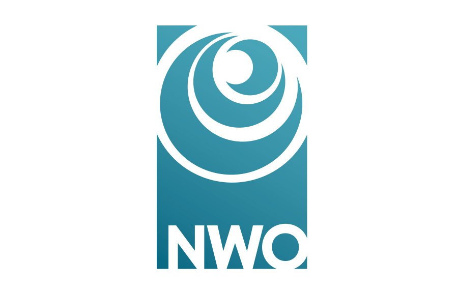

# Robust MPC

**Date:** 23/10/2025

[](https://doi.org/10.5281/zenodo.23809111)

## Overview

This repository contains a collection of functions for the modeling, analysis, and control of Modular Multilevel Converters (MMCs) and Multi-Terminal Direct Current (MTDC) transmission systems.

The main contribution of this repository is a framework for the commissioning and validation of robust state-feedback controllers [1] and model predictive controllers (MPCs) [2] for MMC-based MTDC systems. In addition, it includes well-established methods for stability analysis and robust state-feedback control design.

The presented solutions have been developed in MATLAB. The resulting controllers can be deployed on RTDS platforms using CBuilder blocks.

---

## Structure
The solution is comprised of three main parts:

### 1. Build State-Space Realization of MMC Dynamics
- Run `getPlantModel()` function to obtain state-space (ss) matrices `(A,B,C)` corresponding to the continuous time.
- Run `c2d()` function to discretize the ss.
- Run `getAugmentedSystem()` function to obtain an augmented ss with an integrator defined by rated dynamics `\Delta u(k) = u(k)-u(k-1)`.

### 2. Build hyperbox containing uncertainty, state and input sets
- Run `fineGrid2D()` function to generate a fine grid with a set of uncertain parameters.
- Run `hyperboxVertices()` function to generate all vertices of the hyperbox given its extrem values.

### 3. Robust MPC Design via Controller Matching with Vertex Relaxation
- Run `getRobustK()` function to compute a robust state feedback gain `K`, i.e., an unconstrained control law.
- Run `matchingControlMPC()` function to compute `Q, R, P` by solving LMI from `[ ]`, i.e., controller matching with vertex relaxation.
- Run `quadprog()` function to compute optimal control input resulting of the RMPC


### 4. Closed-Loop Simulation
Tools: **MATLAB**
- Run `simMPCwRealPlant()` function to simulate the closed-loop response comprised of MMC and MPC.
- Run `simSystemSateFeedBack()` function to simulate the closed-loop response comprised of MMC and robust state feedback gain `K`.

---

## Installation

1. Install  MATLAB, YALMIP toolbox [here](https://yalmip.github.io/download/) and MOSEK Solver [here](https://www.mosek.com/downloads/).

   **Disclaimer:** The results presented in this repository have only been validated using the MOSEK solver. However, the use of these solutions is not limited to MOSEK. If you do not have access to the MOSEK solver, the code in this repository can still be used by modifying the `opt` variable to select another YALMIP-compatible solver of your choice.
   
2. Download the code. With Git:

   ```bash
   git clone https://github.com/control-protection-grids-tudelft/Robust_MPC.git
   cd Robust_MPC
   ```

   Or use the green **Code → Download ZIP** button at the top of this page.

3. **MATLAB:** open MATLAB in the repository folder and run:

   ```matlab
   cd matlab
   rboc_mmc_install   % adds the project folders to the MATLAB path
   ```


### Your first simulation


**MATLAB:**

```matlab
run('examples/my_first_example.m')
```
---
## Highlights
- **Robustness:** Handles HVDC dynamics (parametric) uncertainties and faults.
- **Integration:** MATLAB and RTDS for simulation.
- **SAFE-GRID Alignment:** Designed for SAFE-GRID project requirements.

---
## References

[1] V. Reyes Dreke, R. Rane and A. Lekić, *"Robust Current Regulation of MMC-based MTDC Power Systems based on Lyapunov Inequality,"* 2026 International Conference on Smart Energy Systems and Technologies (SEST), 2026.

[2] V. Reyes Dreke, R. Rane and A. Lekić, *"Robust Tuning of Model Predictive Control for MMC-Based High-Voltage Power Systems,"* arxiv, 2026.

## Funding

<p>
  
  &nbsp;&nbsp;
  
  &nbsp;&nbsp;
  
</p>

This work is funded by the European Union under the Horizon Europe project **PROSECCO** (Grant Agreement No. 101160687) and by **NWO** through the Veni project **SAFE-GRID** (Project No. 20248). Views and opinions expressed are however those of the author(s) only and do not necessarily reflect those of the European Union or CINEA. Neither the European Union nor the granting authority can be held responsible for them.

